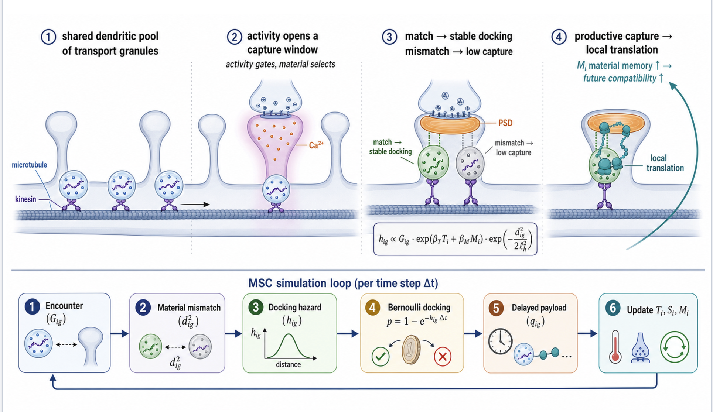

# Material-Selective Capture (MSC)

Code for the preprint

> Gyunesh, A. A. *A material-selective capture model predicts cargo-specific RNA-granule retention at active synapses.

MSC is a coarse-grained stochastic model of RNA-granule transport, synaptic encounter, physical docking, productive capture and delayed postsynaptic reinforcement. Docking depends on an activity tag, a slow material-memory tag and the material mismatch between granule and postsynaptic density.



*Conceptual overview of the MSC model and its stochastic update cycle.*

**Interactive explorer:** [MSC Material Space_.html](https://github.com/user-attachments/files/34180604/MSC.Material.Space_.html)

All results are in-silico predictions. Nothing in this repository is a wet-lab measurement.

## Repository layout

```
model/
  msc_model_feedback.py       the simulator (simulate_one, sample_params, model variants)
  config_msc_feedback.yaml    the 27 sampled parameter intervals and fixed settings
notebooks/                    one self-contained Colab notebook per figure (see table below)
R/                            R scripts for statistics and plotting (see R/README.md)
docs/                         README figure
scripts/                      helper scripts (Middleton source workflow)
```

## Which notebook produces which figure

| Notebook | Manuscript figures | Seeds / replicates | Approx. Colab runtime |
|---|---|---|---|
| — | Fig. 1 (conceptual schematic; no simulation output) | — | — |
| `01_Fig2_Fig3_S1_S5_docking_and_variants.ipynb` | Fig. 2, Fig. 3, Fig. S1, Fig. S5 | 400 matched parameter seeds per variant (Fig. 2: 2,000,000 encounter observations, 6,079 docking events) [+ ERKLÄREN ODER STREICHEN: 200 seeds for …] | several hours |
| `02_Fig4_hysteresis.ipynb` | Fig. 4 | 100 parameter seeds; 11 plateaus per branch, 4,200 s each | several hours |
| `03_Fig5_anti_tautology.ipynb` | Fig. 5 (simulation data; statistics in `R/Fig5_anti_tautology.R`) | 100 seeds; 1,000,000 sampled encounters per variant | several hours |
| `04a_Fig6_S4_Middleton.ipynb` | Fig. 6, Fig. S4 (Middleton, mouse, gene level) | 250 matched pairs (20,000 bootstraps); 100 / 30 / 30 seeds (relaxation time / elastic modulus / mobile fraction); 30 seeds per scaling condition (Fig. S4E) | hours |
| `04b_Fig6_S4_Perez.ipynb` | Fig. 6, Fig. S4 (Perez, rat, gene level) | as 04a | hours |
| `04c_Fig6_S4_Tushev.ipynb` | Fig. 6, Fig. S4 (Tushev, rat, 3′UTR isoforms) | as 04a | hours |
| [SKRIPTNAME] | Fig. 6 / Fig. S4 assembly across the three datasets | — | minutes |
| `05_S2_material_dynamics.ipynb` | Fig. S2, Supplementary Note 3 | 100 parameter seeds (panel B docking: 99 finite seeds; panel F: 50) | hours |
| `06_S3_sensitivity.ipynb` | Fig. S3 | A–C: 500 Latin-hypercube sets × 4 replicates; D–E: 30 replicates per value; F: 15 replicates per Hill coefficient | hours |
| `MSC-Material-Space` (`index.html`) | Interactive explainer; not a manuscript figure | browser RNG (values differ from Python runs) | seconds |

Notebooks 01–04 and 06 require `model/msc_model_feedback.py` and `model/config_msc_feedback.yaml`;
notebook 05 additionally requires the dynamic-material wrapper `model/[WRAPPER].py`.
Dataset-specific inputs are listed below.

Each notebook asks you to upload `model/msc_model_feedback.py` and `model/config_msc_feedback.yaml` (plus dataset-specific inputs, see below), runs top to bottom, and downloads one ZIP bundle. Every bundle contains a `MANIFEST_*.json` with SHA-256 hashes of all inputs and outputs and a `10_r_input/` (or `04_r_input/`, `05_r_input/`) folder with the tables used for plotting.

## How to reproduce

1. Open a notebook in Google Colab (*File -> Upload notebook*, or the "Open in Colab" button on GitHub).
2. Run all cells. Upload the two files from `model/` when prompted.
3. Notebooks `02` and `03` start with `SMOKE = True` (a 3-seed test run). Set `SMOKE = False` and restart the runtime for the full publication run.
4. Notebook `01` checks the run against the archived canonical values: 2,000,000 encounter observations, 6,079 docking events, and the Fig. 2 logistic coefficients. If all checks print `PASS`, the run is bit-identical to the published figure.

The archived runs used the files in `model/` with these hashes:

| File | SHA-256 (first 16) |
|---|---|
| `msc_model_feedback.py` | `3b0151bab2baeaf0` |
| `config_msc_feedback.yaml` | `669b82d4190de794` |

Original runs used Python 3.13, NumPy 2.1.3 and pandas 2.2.3 on Google Colab. Other versions may change the last digits of stochastic results.

### Dataset-specific inputs

- **Middleton (GSE115480):** upload `scripts/msc_figure6_middleton_localization_confidence_100seed.py` in addition to the model files. Public data and Ensembl 116 (GRCm39) annotation are downloaded automatically.
- **Perez (GSE157204):** count data, supplementary tables and Ensembl 116 (GRCr8) annotation are downloaded automatically.
- **Tushev (Neuron 2018):** upload the supplementary PASSData table (`1-s2.0-S0896627318302368-mmc2-PASSData.csv`, extracted from Table S1 of Tushev et al. 2018). The rn5 genome and RefGene annotation are downloaded automatically.

## Protocol notes

- **Fig. 4** uses a stateful stepped-drive protocol: the activity tag of the active synapse is clamped at each drive level (0.0 to 1.0 in steps of 0.1, up then down, 4,200 s per plateau), and the complete simulation state is carried between plateaus.
- **S Fig, panel F** (Hill-coefficient hysteresis) uses a different protocol: each amplitude step is a separate `simulate_one` run in which only the final S and M of the previous step are carried over; granule positions, target vectors and the random stream are re-drawn, and activity is applied as a single pulse (amplitudes 0 to 1.6, saturating at 1). Its branch-separation values are therefore not directly comparable with Fig. 4E.
- **S Fig** wraps the unmodified simulator. With drift disabled the wrapper is checked to be bit-identical to `simulate_one`.

## Data

Large raw outputs (encounter-level parquet files, checkpoints) are not stored in this repository. 

## Citation

If you use this code, please cite the preprint (see `CITATION.cff`).

## License

Code: MIT License (see `LICENSE`).
